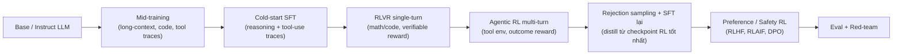
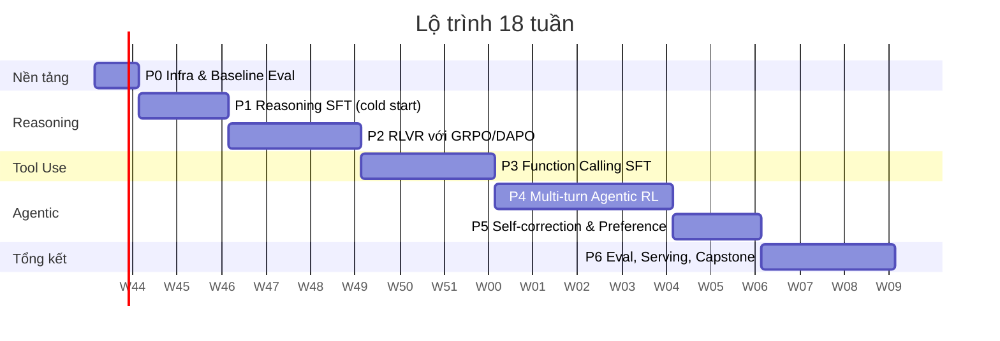
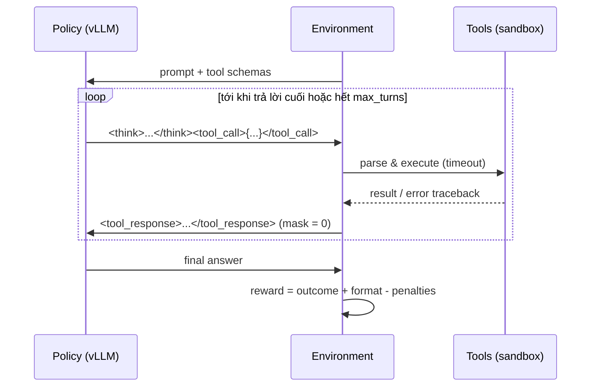
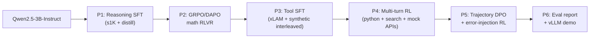

# Lộ trình: Từ Non-Reasoning LLM → Agentic Reasoning Model

> Góc nhìn: Senior Post-Training & Agentic AI Engineer
> Đối tượng: đã biết SFT / GRPO / CPO / ORPO (cho translation)
> Phần cứng: Google Colab Pro (T4 16GB / L4 24GB / A100 40GB, giới hạn compute units)
> Thời lượng đề xuất: ~18 tuần (part-time 10–15h/tuần)

---

## 0. Bức tranh tổng thể — các lab thực sự làm gì?

Pipeline post-training của một model kiểu Claude Sonnet / DeepSeek-R1 / Kimi K2 / GLM-4.5 (đã đơn giản hoá):



**Những insight cốt lõi bạn cần "ngấm" trước khi bắt tay vào:**

| # | Insight | Hệ quả thực hành |
|---|---------|------------------|
| 1 | **SFT dạy *format* và *hành vi khởi đầu*; RL dạy *năng lực thật*.** | SFT ít nhưng sạch (1k–20k mẫu), dồn compute cho RL. |
| 2 | **Reward phải verifiable** (đúng/sai kiểm chứng được) thì RL mới ổn định. | Chọn task có checker: math, code test, JSON schema, kết quả tool. |
| 3 | **Agent = policy chạy trong environment.** Chất lượng env & reward quan trọng ngang model. | Bạn sẽ dành ~40% thời gian để viết env, sandbox, reward. |
| 4 | **Tool output KHÔNG được tính loss.** | Bắt buộc phải có *loss mask* chuẩn ở cả SFT và RL multi-turn. |
| 5 | **Self-correction chủ yếu "emerge" từ RL** khi model thấy lỗi thật (traceback, kết quả rỗng) và được thưởng khi sửa đúng. | Môi trường phải trả về lỗi có thông tin, cho phép nhiều turn. |
| 6 | **Model nhỏ (<3B) khó tự "aha" từ zero-RL**; cần cold-start SFT hoặc distillation. | Với Colab: distill từ teacher mạnh → rồi RL. |

Khác biệt so với kinh nghiệm translation của bạn:

| | Translation (bạn đã làm) | Agentic Reasoning (mục tiêu) |
|---|---|---|
| Reward | COMET/BLEU/LLM-judge (mềm, nhiễu) | Exact-match, unit test, tool success (cứng, ít nhiễu) |
| Độ dài output | Ngắn, cố định | Dài (1k–8k tokens), biến thiên mạnh |
| Số turn | 1 | Nhiều turn, xen kẽ tool output |
| Bottleneck | Train | **Rollout / generation** (chiếm 70–90% thời gian) |
| Failure mode chính | Hallucination, bỏ câu | Reward hacking, entropy collapse, length explosion, tool spam |

---

## 1. Chiến lược phần cứng & chọn model cho Colab Pro

### 1.1 Thực tế compute

- Colab Pro ≈ 100 compute units/tháng. Tham khảo (biến động theo thời điểm):
  T4 ≈ 1.5–2 CU/h, L4 ≈ 4–5 CU/h, A100 ≈ 10–13 CU/h.
  ⇒ ~8h A100 **hoặc** ~20h L4 **hoặc** ~50h T4 mỗi tháng.
- Session có thể bị ngắt ⇒ **luôn checkpoint lên Google Drive / HF Hub mỗi 25–50 steps**.
- Nguyên tắc: **debug trên T4 với model 0.5B**, chỉ bật A100 khi pipeline đã chạy end-to-end.

### 1.2 Model đề xuất

| Vai trò | Model | Lý do |
|---|---|---|
| Debug pipeline | `Qwen2.5-0.5B-Instruct` | Chạy được cả trên T4, iterate nhanh. |
| **Model chính cho RL** | `Qwen2.5-1.5B-Instruct` / `Qwen2.5-3B-Instruct` | Sweet spot: đủ thông minh để RL có tín hiệu, vừa A100/L4 với LoRA + vLLM. |
| SFT lớn hơn (tuỳ chọn) | `Qwen2.5-7B-Instruct` (QLoRA) / `Llama-3.1-8B-Instruct` | Chỉ SFT, RL trên 7B tốn compute. |
| Teacher sinh dữ liệu | API model mạnh (Claude, DeepSeek-R1/V3, Qwen3-235B…) | Distillation trace reasoning + tool. |

> [!NOTE]
> Tránh dùng model *đã* có thinking (vd. Qwen3 ở thinking mode) làm điểm xuất phát — bạn sẽ không học được gì về cách tạo ra năng lực reasoning. Dùng bản Instruct non-reasoning (Qwen2.5, Llama-3.x, hoặc Qwen3 Instruct non-thinking) để thấy rõ delta.

### 1.3 Stack công cụ

| Mục đích | Công cụ |
|---|---|
| SFT / DPO / GRPO tiết kiệm VRAM | **Unsloth** (+ TRL bên dưới) |
| Trainer chuẩn | **TRL** (`SFTTrainer`, `GRPOTrainer`, `DPOTrainer`) |
| Rollout nhanh | **vLLM** (Unsloth có `fast_inference=True` tích hợp vLLM) |
| Agentic RL multi-turn (đọc code, scale sau này) | `verl`, `OpenRLHF`, `SkyRL`, `rLLM`, `verifiers` (Prime Intellect), `ART` (OpenPipe) |
| Eval | `lm-evaluation-harness`, BFCL (Gorilla), τ²-bench, script tự viết |
| Tracking | Weights & Biases |
| Sandbox chạy code | `subprocess` + timeout + resource limit (Colab), hoặc E2B/Docker khi lên server |

> [!IMPORTANT]
> Các thư viện này thay đổi API rất nhanh. Luôn pin version trong notebook (`pip install trl==X.Y.Z`) và đọc changelog trước mỗi phase.

---

## 2. Tổng quan lộ trình



| Phase | Kết quả đầu ra (deliverable) | Compute ước tính |
|---|---|---|
| P0 | Eval harness + baseline số liệu | T4, ~5h |
| P1 | `model-sft-think`: biết `<think>…</think>` | L4/A100, ~3–5h |
| P2 | `model-r1`: GRPO tăng MATH/GSM8K rõ rệt | A100, ~10–15h |
| P3 | `model-tool-sft`: gọi tool đúng schema, biết khi nào *không* gọi | L4, ~5h |
| P4 | `model-agent-rl`: multi-turn, interleaved thinking + tool | A100, ~15–25h |
| P5 | Agent biết tự sửa lỗi, ít tool spam | L4/A100, ~5–8h |
| P6 | Báo cáo eval + demo agent chạy với vLLM | T4/L4 |

⇒ Tổng ~2–3 tháng Colab Pro, có thể cần mua thêm compute units ở P2/P4.

---

## Phase 0 — Infra, Chat Template & Baseline (Tuần 1)

### Mục tiêu
Hiểu tận gốc **chat template + special tokens + loss mask**, vì 50% bug của agentic training nằm ở đây.

### Lý thuyết cần nắm
- Chat template Jinja của Qwen2.5: cách render `system / user / assistant / tool`, block `<tools>`, `<tool_call>`, `<tool_response>`.
- Khác biệt *Hermes-style* (JSON trong `<tool_call>`) vs *OpenAI-style* (`tool_calls` field) vs *Pythonic* (Llama 3.2).
- Tại sao phải thêm token `<think>` / `</think>` (hoặc dùng text thường) — trade-off giữa thêm token mới (phải train embedding) và dùng chuỗi text có sẵn.

### Thực hành
1. Render một hội thoại multi-turn có tool bằng `tokenizer.apply_chat_template(messages, tools=tools, tokenize=False)`. In ra và đọc **từng token**.
2. Viết hàm tạo `assistant_mask` cho multi-turn (chỉ tính loss trên token assistant):

```python
def build_labels(tokenizer, messages, tools=None):
    """Tokenize từng message tăng dần, chỉ giữ label cho phần assistant sinh ra."""
    input_ids, labels = [], []
    prev_len = 0
    for i in range(len(messages)):
        text = tokenizer.apply_chat_template(
            messages[: i + 1], tools=tools, tokenize=False,
            add_generation_prompt=False,
        )
        ids = tokenizer(text, add_special_tokens=False)["input_ids"]
        new_ids = ids[prev_len:]
        input_ids += new_ids
        if messages[i]["role"] == "assistant":
            labels += new_ids          # học phần này
        else:
            labels += [-100] * len(new_ids)  # system/user/tool: không học
        prev_len = len(ids)
    return input_ids, labels
```

> [!WARNING]
> Cách "tokenize tăng dần" chỉ đúng nếu template có tính *prefix-consistent*. Một số template (vd. xoá `<think>` của các turn trước) phá vỡ điều này — hãy assert `ids[:prev_len] == input_ids` để phát hiện.

3. **Baseline eval** model gốc trên (dùng vLLM, greedy + sample@k):
   - GSM8K (500 mẫu), MATH-500 → reasoning
   - BFCL subset (simple, multiple, parallel, irrelevance) → tool calling
   - 50 câu HotpotQA → multi-hop (sẽ dùng ở P4)
4. Setup checkpoint tự động lên HF Hub (private repo) + W&B.

### Checklist hoàn thành
- [ ] Giải thích được từng token trong prompt có tool
- [ ] Hàm `build_labels` có unit test
- [ ] Bảng baseline (lưu vào `results/baseline.md`)

---

## Phase 1 — Reasoning SFT / Cold-Start Distillation (Tuần 2–3)

### Mục tiêu
Dạy model *format* suy luận dài: `<think>` → explore → verify → backtrack → trả lời.

### Đọc
- DeepSeek-R1 tech report (mục Cold Start, Distillation)
- **s1: Simple test-time scaling** (1k mẫu + budget forcing)
- **LIMO: Less is More for Reasoning**
- OpenThoughts / OpenR1 reports (data curation)

### Dữ liệu
| Dataset | Ghi chú |
|---|---|
| `simplescaling/s1K-1.1` | 1k mẫu chất lượng cao, khởi đầu tốt nhất |
| `GAIR/LIMO` | ~800 mẫu |
| `open-r1/OpenR1-Math-220k` | Lọc ra 5–20k mẫu đã verify đúng |
| `open-thoughts/OpenThoughts-114k` | Math + code + science |

### Thực hành
1. **Exp 1.1**: SFT `Qwen2.5-1.5B-Instruct` trên s1K, LoRA r=64 (hoặc full FT nếu A100), max_seq_len 8192, 3–5 epochs, lr 1e-5 (full) / 1e-4 (LoRA).
2. **Exp 1.2**: So sánh 1k vs 10k mẫu; trace ngắn vs dài. Ghi nhận: độ dài trace ảnh hưởng thế nào lên model nhỏ? (model nhỏ thường bị "lặp vô hạn" khi học trace quá dài).
3. **Exp 1.3**: Tự sinh trace bằng teacher API cho domain bạn quan tâm, **lọc bằng verifier** (chỉ giữ trace có đáp án đúng) = *rejection sampling distillation*.
4. Implement **budget forcing** lúc inference: ép thêm "Wait" khi model dừng sớm; cắt khi vượt budget.

### Điểm cần chú ý
- Packing + attention mask đúng (không để mẫu nhìn thấy nhau) — dùng `padding_free` / flash-attn varlen.
- Theo dõi tỉ lệ output **không đóng `</think>`** và **lặp vô hạn** — đây là metric quan trọng hơn loss.

### Checklist
- [ ] MATH-500 tăng so với baseline (kỳ vọng +5–15 điểm ở 1.5B)
- [ ] Tỉ lệ format hợp lệ > 95%
- [ ] Hiểu tại sao "ít mà chất" thắng "nhiều mà nhiễu"

---

## Phase 2 — RL with Verifiable Rewards: GRPO → DAPO (Tuần 4–6)

### Mục tiêu
Chuyển từ GRPO cho translation (reward mềm) sang RLVR (reward cứng), hiểu sâu các biến thể và failure modes.

### Đọc (theo thứ tự)
1. DeepSeekMath (GRPO gốc), DeepSeek-R1 (R1-Zero)
2. **Dr. GRPO** — "Understanding R1-Zero-Like Training" (bias độ dài & std normalization)
3. **DAPO** — clip-higher, dynamic sampling, token-level loss, overlong reward shaping
4. **GSPO** (Qwen) — sequence-level importance ratio, ổn định hơn cho MoE / long seq
5. "The Entropy Mechanism of RL for Reasoning LMs" — entropy collapse
6. TinyZero / "Countdown" replication — aha moment trên model nhỏ

### Thiết kế reward

```python
import re

THINK_RE = re.compile(r"^<think>.*?</think>\s*(.+)$", re.S)

def format_reward(completions, **kwargs):
    """1.0 nếu có đúng một block <think>...</think> theo sau là câu trả lời."""
    out = []
    for c in completions:
        text = c[0]["content"] if isinstance(c, list) else c
        out.append(1.0 if THINK_RE.match(text.strip()) else 0.0)
    return out

def correctness_reward(completions, answer, **kwargs):
    """So khớp đáp án cuối trong \\boxed{} với ground truth (dùng math_verify cho chuẩn)."""
    from math_verify import parse, verify
    out = []
    for c, gt in zip(completions, answer):
        text = c[0]["content"] if isinstance(c, list) else c
        try:
            out.append(1.0 if verify(parse(gt), parse(text)) else 0.0)
        except Exception:
            out.append(0.0)
    return out
```

> [!TIP]
> Bắt đầu với reward **chỉ có correctness + format nhỏ (0.1–0.2)**. Đừng thêm reward cho độ dài hay "có chữ Wait" — đó là con đường ngắn nhất đến reward hacking.

### Thực hành
1. **Exp 2.1 – Countdown (TinyZero)**: Qwen2.5-1.5B, zero-RL (không SFT). Quan sát response length tăng và sự xuất hiện của self-verification.
2. **Exp 2.2 – GSM8K/MATH**: GRPO trên checkpoint P1. Config khởi điểm cho A100 40GB + LoRA:
   - `num_generations` (G) = 8, `max_completion_length` = 2048–4096
   - lr = 1e-6 (full) / 5e-6–1e-5 (LoRA), `beta` (KL) = 0–0.04
   - Lọc prompt quá dễ/quá khó (pass@8 = 0 hoặc 8 ⇒ advantage = 0 ⇒ lãng phí)
3. **Exp 2.3 – Ablation DAPO**: lần lượt bật clip-higher (ε_high=0.28), token-level loss, dynamic sampling, overlong penalty. Ghi lại ảnh hưởng lên entropy & accuracy.
4. **Exp 2.4 – Rejection sampling SFT**: lấy checkpoint RL tốt nhất, sample nhiều, giữ trace đúng & ngắn nhất → SFT lại model gốc. So sánh với model RL.

### Dashboard bắt buộc theo dõi
| Metric | Dấu hiệu xấu |
|---|---|
| `reward/mean` | Tăng vọt bất thường → nghi reward hacking, đọc sample ngay |
| `entropy` | Giảm về ~0 nhanh → entropy collapse, tăng ε_high / giảm lr |
| `completion_length` | Tăng không kiểm soát, nhiều bản bị cắt → overlong penalty |
| `frac_reward_zero_std` | Cao → batch vô dụng, cần lọc lại độ khó |
| `clip_ratio`, `kl` | Spike → lr quá cao |

> [!IMPORTANT]
> Quy tắc vàng: **cứ mỗi 20–50 steps, đọc tay 5–10 rollouts**. Metric không bao giờ cho bạn thấy model đang lừa reward như thế nào.

### Checklist
- [ ] Tái hiện được "aha moment" trên Countdown
- [ ] Giải thích được bias độ dài trong GRPO gốc và cách Dr. GRPO/DAPO sửa
- [ ] Viết được post-mortem 1 lần training thất bại

---

## Phase 3 — Function Calling SFT (Tuần 7–9)

### Mục tiêu
Model gọi tool **đúng schema, đúng lúc, đúng tham số**, biết gọi song song, biết **từ chối** khi không có tool phù hợp, và **xen kẽ thinking với tool call**.

### Đọc
- Toolformer, Gorilla, **APIGen / xLAM** (Salesforce), **ToolACE**, Hermes function-calling format
- BFCL (Berkeley Function Calling Leaderboard) — các category và cách chấm AST
- When2Call (khi nào không nên gọi tool)
- Anthropic: "Building effective agents", tài liệu *interleaved thinking* & tool use

### Format mục tiêu (interleaved thinking + tool)

```text
<|im_start|>assistant
<think>
User hỏi thời tiết Hà Nội và đổi sang °F. Cần get_weather trước, sau đó tự tính.
</think>
<tool_call>
{"name": "get_weather", "arguments": {"city": "Hanoi", "unit": "celsius"}}
</tool_call><|im_end|>
<|im_start|>user
<tool_response>
{"temp": 28, "condition": "cloudy"}
</tool_response><|im_end|>
<|im_start|>assistant
<think>
28°C → 28*9/5+32 = 82.4°F.
</think>
Hà Nội hiện 28°C (≈82.4°F), trời nhiều mây.<|im_end|>
```

### Dữ liệu
| Dataset | Dùng cho |
|---|---|
| `Salesforce/xlam-function-calling-60k` | Single/parallel call, chất lượng cao (đã verify) |
| `NousResearch/hermes-function-calling-v1` | Format Hermes, multi-turn |
| `Team-ACE/ToolACE` | Đa dạng API, có dialog |
| `glaiveai/glaive-function-calling-v2` | Bổ sung, cần lọc |
| Tự sinh | Trace multi-step có thinking + lỗi + recovery |

### Thực hành
1. **Exp 3.1**: Chuẩn hoá tất cả dataset về một format duy nhất (message list + `tools` JSON schema). Viết validator: JSON parse được, tên tool tồn tại, tham số khớp schema (`jsonschema`).
2. **Exp 3.2 – Synthetic data pipeline** (kỹ năng quan trọng nhất của phase này):
   ```mermaid
   flowchart LR
       T["Tool pool<br/>(mock APIs có code thật)"] --> Q["Teacher sinh query<br/>đa dạng độ khó"]
       Q --> R["Teacher giải bằng<br/>thinking + tool calls"]
       R --> X["Thực thi tool thật<br/>trong sandbox"]
       X --> V{"Verifier:<br/>schema + kết quả<br/>+ LLM judge"}
       V -- pass --> D[(SFT data)]
       V -- fail --> R
   ```
   - Cố ý chèn ~15% trace có **tool lỗi** (timeout, 404, sai tham số) và teacher **tự sửa** → hạt giống cho self-correction.
   - Chèn ~10–15% mẫu **không cần tool** / **không có tool phù hợp** → chống tool spam & hallucinated tools.
3. **Exp 3.3**: SFT từ checkpoint P2 (đã có reasoning). Kiểm tra *catastrophic forgetting* trên MATH-500.
4. **Exp 3.4**: Eval BFCL (simple / multiple / parallel / parallel_multiple / irrelevance / multi-turn).

### Checklist
- [ ] BFCL AST accuracy tăng rõ rệt so với baseline
- [ ] Irrelevance detection > 80%
- [ ] Reasoning (MATH-500) không giảm quá 2–3 điểm

---

## Phase 4 — Multi-turn Agentic RL (Tuần 10–13) ⭐ Trọng tâm

### Mục tiêu
Huấn luyện bằng RL trong môi trường có tool thật, nơi model **tự quyết định** khi nào suy nghĩ, khi nào gọi tool, đọc kết quả, và lặp lại.

### Đọc
- **Search-R1**, **ReSearch**, **ZeroSearch** — RL cho search agent
- **ReTool**, **ToRL**, **SimpleTIR** — RL cho code-interpreter agent
- **RAGEN / StarPO** — multi-turn RL, "echo trap"
- Kimi K2, GLM-4.5, DeepSeek-V3.1 tech reports — agentic data & RL ở quy mô lớn
- WebSailor / WebDancer (Alibaba Tongyi) — long-horizon web agent

### Kiến trúc rollout multi-turn



### Pseudo-code cốt lõi (tự viết để hiểu, trước khi dùng framework)

```python
def rollout(llm, tokenizer, prompt_msgs, tools, env, max_turns=5, max_tokens=8192):
    """Trả về token_ids, loss_mask (1 = token do policy sinh), và reward."""
    text = tokenizer.apply_chat_template(prompt_msgs, tools=tools,
                                         tokenize=False, add_generation_prompt=True)
    ids = tokenizer(text, add_special_tokens=False)["input_ids"]
    mask = [0] * len(ids)

    for turn in range(max_turns):
        out = llm.generate(ids, stop=["</tool_call>", "<|im_end|>"],
                           include_stop_str_in_output=True)
        gen_ids = out.token_ids
        ids += gen_ids
        mask += [1] * len(gen_ids)            # policy tokens → học

        call = env.parse_tool_call(out.text)
        if call is None:                       # model đã trả lời cuối
            break
        obs = env.execute(call)                # có timeout, bắt exception
        obs_text = f"<|im_end|>\n<|im_start|>user\n<tool_response>\n{obs}\n</tool_response><|im_end|>\n<|im_start|>assistant\n"
        obs_ids = tokenizer(obs_text, add_special_tokens=False)["input_ids"]
        ids += obs_ids
        mask += [0] * len(obs_ids)             # env tokens → KHÔNG học
        if len(ids) > max_tokens:
            break

    reward = env.score(tokenizer.decode(ids))
    return ids, mask, reward
```

> [!WARNING]
> Bug kinh điển: **re-tokenize** toàn bộ text sau mỗi turn làm token ids khác với lúc sinh ra (tokenization không khả nghịch) ⇒ log-prob sai ⇒ RL không hội tụ. Luôn **nối token ids**, đừng nối string rồi tokenize lại.

### Môi trường thực hành (làm theo thứ tự)

| Env | Tool | Reward | Dataset | Độ khó |
|---|---|---|---|---|
| **E1: Math + Python** (ToRL-style) | `python(code)` sandbox | Đúng đáp án | GSM8K, MATH | ⭐ |
| **E2: Search agent** (Search-R1-style) | `search(query)` BM25 trên Wikipedia dump nhỏ | EM/F1 | NQ, HotpotQA | ⭐⭐ |
| **E3: Multi-tool task** | 5–10 mock API (calendar, db, weather…) có state | Kiểm tra state cuối của env | Tự sinh (từ P3) | ⭐⭐⭐ |
| **E4 (tuỳ chọn): τ-bench-lite** | Retail/airline mock + user simulator | Kiểm tra DB state | Tự xây | ⭐⭐⭐⭐ |

### Reward shaping cho agent

```text
R = R_outcome                       # 1/0 hoặc F1 — tín hiệu chính
  + 0.1 * R_format                  # tool call parse được, đóng thẻ đúng
  - 0.05 * max(0, n_calls - k)      # phạt tool spam (cẩn thận: dễ làm model ngại gọi tool)
  - 0.5  * [hallucinated_tool]      # gọi tool không tồn tại
```

### Kỹ thuật bắt buộc
- **Loss mask** cho tool output (như trên).
- **Max turns + max tokens** cứng; trajectory bị cắt ⇒ reward 0 hoặc overlong penalty.
- **Async / batched tool execution** — tool chậm sẽ giết throughput.
- **Lọc prompt theo pass-rate** sau mỗi epoch (curriculum).
- **Group theo prompt** như GRPO; advantage tính ở mức trajectory, broadcast tới mọi token của policy.

### Framework
- Trên Colab: tự viết rollout + TRL/Unsloth GRPO (hoặc thư viện nhẹ như `verifiers`, `ART`) cho 1.5B–3B.
- Đọc source `verl` (multi-turn rollout, `agent_loop`) và `SkyRL`/`rLLM` để hiểu cách scale — đây là kiến thức phỏng vấn/làm việc tại lab.

### Checklist
- [ ] E1: accuracy MATH với tool > không tool
- [ ] E2: EM HotpotQA tăng rõ rệt so với model SFT-only
- [ ] Quan sát được hành vi **tự sửa** (gọi lại tool sau lỗi) trong rollouts
- [ ] Viết được phân tích: số tool call trung bình, phân bố số turn theo thời gian training

---

## Phase 5 — Self-Correction, Planning & Preference (Tuần 14–15)

### Mục tiêu
Nâng chất lượng hành vi: lập kế hoạch rõ ràng, tự kiểm tra, ít lãng phí, an toàn khi dùng tool.

### Đọc
- SCoRe (Google DeepMind) — RL multi-turn cho self-correction
- Reflexion, Self-Refine, CRITIC
- Process Reward Models: "Let's Verify Step by Step", Math-Shepherd; tranh luận PRM vs ORM (DeepSeek-R1 report phần "unsuccessful attempts")
- Constitutional AI / RLAIF (Anthropic)

### Thực hành (tận dụng kinh nghiệm CPO/ORPO/DPO của bạn)
1. **Exp 5.1 – Trajectory preference**: Từ rollouts P4, tạo cặp (chosen = đúng & ít bước, rejected = đúng nhưng vòng vo / sai). Chạy **DPO / ORPO / KTO** ở mức trajectory (nhớ mask tool output). So sánh với tiếp tục GRPO.
2. **Exp 5.2 – Error-injection env**: Môi trường cố ý trả về lỗi ngẫu nhiên 20% (timeout, rate limit, dữ liệu sai lệch). Thưởng khi model phát hiện & retry/đổi chiến lược thành công.
3. **Exp 5.3 – Plan-then-act**: SFT/RL để model viết plan ngắn trong `<think>` đầu tiên, rồi thực thi. Đo: có giảm số turn thừa không?
4. **Exp 5.4 – Safety cho agent**: tạo bộ test prompt injection trong tool output ("ignore previous instructions…"), tool nguy hiểm (`delete_all`) → model phải hỏi xác nhận/từ chối.

### Checklist
- [ ] Số tool call trung bình giảm mà accuracy không giảm
- [ ] Tỉ lệ recovery sau lỗi tăng
- [ ] Có bộ test prompt-injection và số liệu

---

## Phase 6 — Evaluation, Serving & Capstone (Tuần 16–18)

### Eval suite cuối
| Năng lực | Benchmark |
|---|---|
| Reasoning | GSM8K, MATH-500, AIME 24/25 (pass@1, avg@16) |
| Function calling | BFCL (v3/v4 các category khả dụng) |
| Multi-hop + search | HotpotQA, 2Wiki, Bamboogle |
| Agentic có state | τ²-bench (retail/airline) hoặc env E3 tự xây |
| Hiệu quả | Tokens / task, tool calls / task, latency |
| Độ bền | Prompt injection, tool lỗi, schema lạ chưa thấy |

> [!CAUTION]
> Kiểm tra **contamination**: dữ liệu teacher sinh ra có thể chứa câu hỏi benchmark. Dedup bằng n-gram / embedding giữa train và test trước khi báo cáo.

### Serving
- Merge LoRA → serve bằng **vLLM** với tool-call parser (`--enable-auto-tool-choice --tool-call-parser hermes`) và reasoning parser phù hợp.
- Viết agent loop tối giản (OpenAI-compatible client) + 3–5 tool thật (search, python, file).
- Demo Gradio/Streamlit hiển thị thinking + tool calls theo thời gian thực.

### 🎯 Capstone: **"Mini-Agent-R1"**



Deliverables:
1. Model trên HF Hub + model card (data, recipe, hyperparams, số liệu so với baseline ở mọi stage).
2. Technical report 4–6 trang kiểu tech report của lab: ablation, failure analysis, ví dụ trajectory.
3. Repo code sạch: `data/`, `envs/`, `rewards/`, `train/`, `eval/`.

---

## 3. Cấu trúc repo đề xuất

```text
agentic-ai-training/
├── agentic_reasoning_roadmap.md
├── notebooks/            # Colab notebooks theo phase: p0_infra.ipynb, p1_sft.ipynb ...
├── data/
│   ├── build_reasoning_sft.py
│   ├── build_tool_sft.py
│   └── synth/            # pipeline sinh dữ liệu bằng teacher
├── envs/
│   ├── base.py           # Env interface: reset / step / score
│   ├── python_sandbox.py
│   ├── search_bm25.py
│   └── mock_apis/
├── rewards/
│   ├── math_reward.py
│   ├── format_reward.py
│   └── tool_reward.py
├── train/
│   ├── sft.py
│   ├── grpo_single_turn.py
│   ├── grpo_multi_turn.py  # rollout tự viết + loss mask
│   └── dpo_trajectory.py
├── eval/
│   ├── run_math.py
│   ├── run_bfcl.py
│   └── run_agent_env.py
└── results/
```

---

## 4. Failure modes thường gặp & cách xử lý

| Triệu chứng | Nguyên nhân thường gặp | Xử lý |
|---|---|---|
| Reward tăng, chất lượng giảm | Reward hacking (vd. in nhiều đáp án, đoán mò format) | Siết verifier, chỉ lấy đáp án cuối, đọc rollouts |
| Entropy → 0, accuracy chững | Entropy collapse | Clip-higher, giảm lr, tăng temperature rollout (1.0), bỏ KL |
| Output dài vô tận, lặp | Học trace quá dài / thiếu overlong penalty | Overlong shaping, giảm max len, SFT trace ngắn hơn |
| Model không bao giờ gọi tool | Phạt tool quá nặng / SFT thiếu | Giảm penalty, thêm cold-start tool SFT, reward cho tool hợp lệ |
| Model gọi tool liên tục | Không phạt / không có max turns | Max turns, penalty nhẹ, mẫu "không cần tool" |
| Loss RL bất thường, KL nổ | Logprob mismatch (re-tokenize, template khác giữa vLLM & trainer) | Nối token ids, cùng tokenizer/template, kiểm tra importance ratio ≈ 1 ở step đầu |
| Mất khả năng chat thường | Over-specialization | Trộn 10–20% dữ liệu general chat vào SFT, KL nhỏ |
| OOM trên Colab | Seq dài × G lớn | Gradient checkpointing, giảm G, LoRA, `vllm gpu_memory_utilization` 0.4–0.6 |

---

## 5. Danh sách đọc (ưu tiên ★)

**Reasoning & RL**
- ★ DeepSeek-R1 (2025); ★ DeepSeekMath (GRPO)
- ★ DAPO; ★ Dr. GRPO ("Understanding R1-Zero-Like Training"); GSPO; VAPO
- s1: Simple Test-Time Scaling; LIMO
- Kimi k1.5 tech report (long-CoT RL, length penalty)
- The Entropy Mechanism of RL for Reasoning LMs

**Tool use & Agentic RL**
- ★ Search-R1; ★ ReTool; ToRL; SimpleTIR; ZeroSearch
- ★ RAGEN (StarPO); SCoRe
- APIGen / xLAM; ToolACE; Gorilla & BFCL
- τ-bench / τ²-bench
- Kimi K2, GLM-4.5, Qwen3 tech reports (phần agentic data & RL)

**Engineering & thực tiễn**
- ★ Anthropic — "Building Effective Agents"; tài liệu tool use & extended/interleaved thinking
- HybridFlow (verl) paper — kiến trúc RL hệ thống
- Blog/Docs: Unsloth GRPO, TRL GRPOTrainer, vLLM tool calling

---

## 6. Nhịp làm việc hàng tuần (gợi ý)

| Ngày | Hoạt động |
|---|---|
| Thứ 2 | Đọc 1–2 paper của phase, ghi chú "1 ý tưởng có thể thử" |
| Thứ 3–4 | Code data/env/reward, debug với model 0.5B trên T4 |
| Thứ 5–6 | Chạy experiment chính trên A100/L4 |
| Thứ 7 | Đọc rollouts, viết experiment log (giả thuyết → kết quả → bài học) |
| CN | Nghỉ / đọc tech report các lab |

> [!TIP]
> Giữ một file `results/experiment_log.md`. Ở các lab, kỹ năng quý nhất không phải là chạy được training, mà là **đặt giả thuyết rõ ràng, ablation sạch, và đọc rollouts để hiểu model đang thực sự học gì**.
